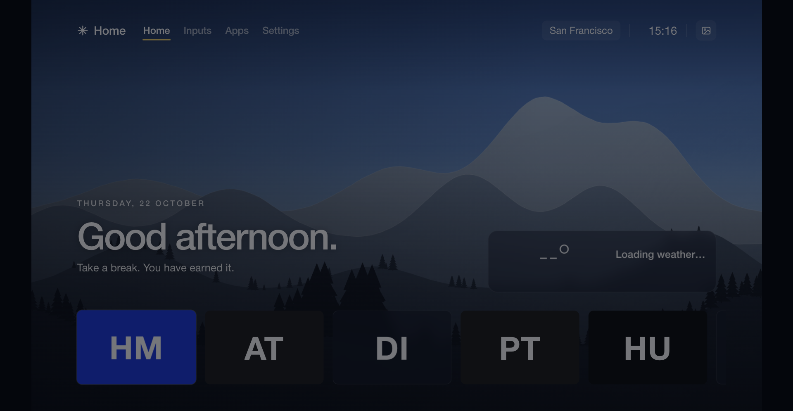
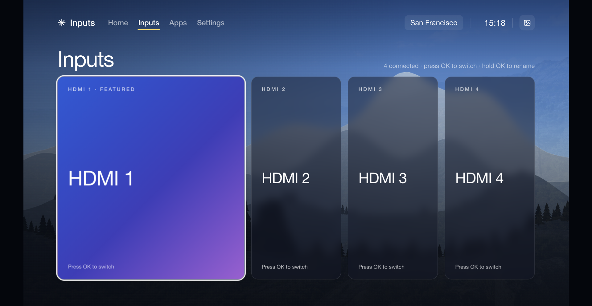
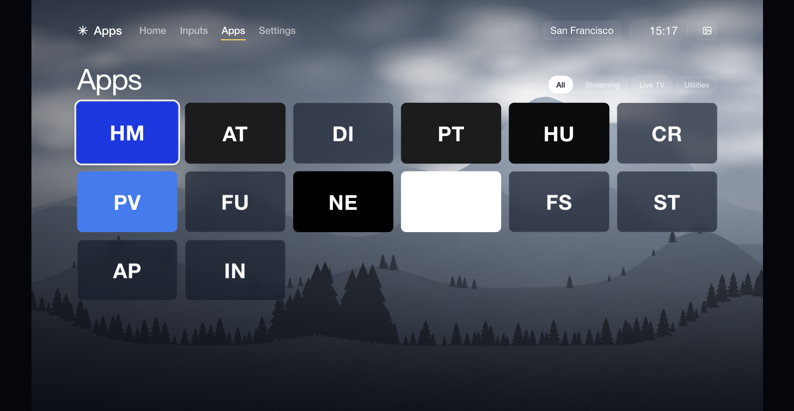
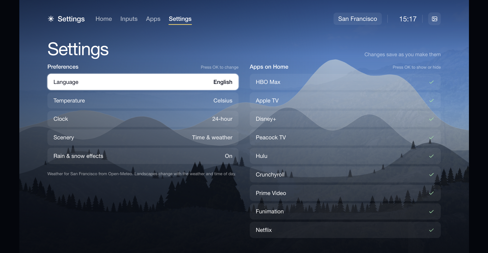

# TV Home

A calm, custom Home screen for Samsung Tizen TVs. It's a small web app with a clock, local weather, a 7-day forecast and a quiet landscape that changes with the weather and the time of day. Four pages — **Home**, **Inputs**, **Apps**, **Settings** — reached from a tab bar at the top.



- **Four tabs** at the top: Home (greeting + weather + favourite apps), Inputs (HDMI devices), Apps (full grid of installed apps with filter chips), Settings (preferences + per-app visibility).
- **Weather** from [Open-Meteo](https://open-meteo.com) (no API key), with hourly and 7-day views.
- **Seven bundled landscapes** for clear, overcast, rain, snow and night, plus warmer dawn and dusk tones.
- **Optional rain and snow effects**, and an ambient mode with just the clock.
- **Remote-first navigation** that also works with the Samsung pointer and a desktop mouse.
- **Hold OK** on an app tile to re-order it. Hold OK on an HDMI card to rename the device.
- **Colour buttons** on the remote act as quick toggles on Home: red for effects, green for °C/°F, yellow for scenery, blue for 12/24-hour clock.
- **English and European Portuguese**, °C/°F, and a 12/24-hour clock, all changeable in Settings.
- **No accounts and no tracking.** The only network request is the weather forecast.

> [!WARNING]
> This is a hobby project and is not affiliated with Samsung. Level 1 installs an ordinary app.
> Levels 2 and 3 use a temporary root session and change system settings on the TV.
> They were tested on **one TV only**, and a mistake there could leave your TV in a bad state.
> Read each guide fully, take the backups it describes and proceed at your own risk.

## The four pages

<table>
  <tr>
    <td width="50%" align="center"><a href="docs/screenshots/home.png"></a><br><sub><strong>Home</strong> — greeting, weather, favourite apps.</sub></td>
    <td width="50%" align="center"><a href="docs/screenshots/inputs.png"></a><br><sub><strong>Inputs</strong> — HDMI devices. Hold OK on a card to rename.</sub></td>
  </tr>
  <tr>
    <td align="center"><a href="docs/screenshots/apps.png"></a><br><sub><strong>Apps</strong> — every installed app, with filter chips.</sub></td>
    <td align="center"><a href="docs/screenshots/settings.png"></a><br><sub><strong>Settings</strong> — preferences and app visibility.</sub></td>
  </tr>
</table>

## Remote cheat sheet

| Press | On | Does |
| --- | --- | --- |
| ◁ ▷ | Home app row | Previous / next tile |
| ◁ ▷ | A tab | Previous / next tab (wraps) |
| ◁ ▷ | Apps grid | Move within the grid |
| △ | Any tile / card / row | Jump to the active tab |
| ▽ | A tab | Back into the current page |
| OK | A tab | Switch to that page |
| OK | An app tile | Launch the app |
| OK | An HDMI card | Switch to that input |
| OK (hold) | An app tile | Reorder mode — ◁ ▷ to move, OK or Back to exit |
| OK (hold) | An HDMI card | Rename — type with the TV's keyboard, OK saves, Back cancels |
| OK | Weather card | Open the 7-day forecast |
| Back | Any page | Returns to Home, then exits the launcher |
| Red | Home | Toggle rain / snow effects |
| Green | Home | Toggle °C / °F |
| Yellow | Home | Cycle scenery (auto / night / dawn / day / dusk) |
| Blue | Home | Toggle 12 / 24-hour clock |

## Three levels

Pick how far you want to go. Each level builds on the previous one.

| Level | What you get | What it takes | Undo |
| --- | --- | --- | --- |
| [1. Install the launcher](docs/1-install.md) | TV Home in your apps list | Developer Mode, Tizen Studio, a free Samsung certificate | Uninstall the app |
| [2. Make it the Home button](docs/2-set-as-home.md) | The remote's Home button opens TV Home | Level 1, the .NET SDK, a temporary root session | `home-routing.py --set stock` |
| [3. Privacy extras](docs/3-privacy.md) | Ad, analytics and content-recognition services stopped | Level 2's tools | Restore scripts included |

## Try it on your computer first

Open `index.html` in Chrome. The desktop preview shows your pinned apps as monogram tiles (no icons bundled) and live weather for the location in `js/config.js`. URL options for jumping straight to a page or scene:

- `index.html?scope=inputs` (also `apps-page`, `settings`)
- `index.html?scenery=night` (also `dawn`, `day`, `dusk`)
- `index.html?open=forecast` (also `ambient`)

Use the arrow keys, Enter and Esc to move around as you would with the remote.

## Customise

Everything you're likely to change is in [`js/config.js`](js/config.js) — or in a gitignored `js/config.local.js` next to it that overrides the shipped values:

- your weather location
- which apps come first, and in what order (each entry can carry a `name`, `icon` and brand `color`)
- HDMI input entries: give them an `input.*` id and a `source: { type: "HDMI", number: N }` and they appear on the Inputs page
- the default language, units and clock

Reinstall with `tools/install.sh` after editing. The landscapes are AI-generated, and [docs/landscapes.md](docs/landscapes.md) has the prompts if you want your own.

## Project layout

```text
index.html, config.xml, icon.png   The Tizen web app
css/                                 Styles, landscapes, HDMI icon
js/                                  App code (config.js is the one to edit; config.local.js overrides)
tools/install.sh                     Package, sign, install and launch on the TV
tools/snapshot.sh                    Tarball the live wgt + Home selectors before a risky push
tools/*.test.cjs                     Unit tests (node --test tools/*.test.cjs)
tools/check-app-row.py               Headless-Chrome layout check (macOS)
tools/tv-root.py                     Run one bounded command as root (level 2)
tools/home-routing.py                Read or switch the Home button target (level 2)
tools/notification-settings.py       Quiet Software Update popups (level 3)
tools/build-helpers.sh               Build the .NET helpers that run on the TV
tools/vendor/samsung-tv-root/        Temporary-root implementation (upstream, public domain)
docs/research/                       Background notes on Tizen, DNS blocking and the privacy package catalog
extras/                              TV backup and privacy scripts (levels 2 and 3)
```

## Tests

```bash
node --test tools/*.test.cjs
```

## Credits

- [chris-ritsen/samsung-tv-root](https://github.com/chris-ritsen/samsung-tv-root) for the temporary-root technique. It's vendored at a pinned commit with a small patch, and [UPSTREAM.md](tools/vendor/samsung-tv-root/UPSTREAM.md) has the details.
- [jss8649/quiet-tizen](https://github.com/jss8649/quiet-tizen) for the Tizen 9 package catalog cross-referenced in [docs/research/package-catalogs/](docs/research/package-catalogs/).
- [Open-Meteo](https://open-meteo.com) for free weather data.
- App names and logos shown on the TV belong to their owners. This repo doesn't include any of them.

## License

MIT, see [LICENSE](LICENSE). The vendored `samsung-tv-root` code is public domain (Unlicense).
