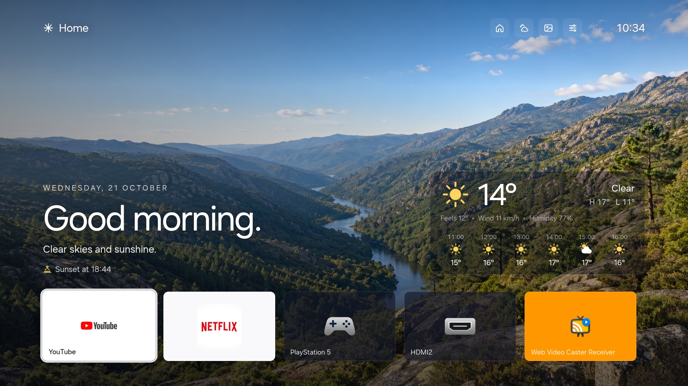

# TV Home

A calm, custom Home screen for Samsung Tizen TVs. It's a small web app with a clock, local weather and a 7-day forecast. The landscape behind it changes with the weather and the time of day, and a single row of your apps and HDMI inputs sits at the bottom.



- **Weather** from [Open-Meteo](https://open-meteo.com) (no API key), with hourly and 7-day views
- **Seven bundled landscapes** for clear, overcast, rain, snow and night, plus warmer dawn and dusk tones
- **Optional rain and snow effects**, and an ambient mode with just the clock
- **App row** with installed apps in your chosen order, plus tiles that switch straight to an HDMI input
- **Remote-first navigation** that also works with the Samsung pointer and a desktop mouse
- **English and European Portuguese**, °C/°F, and a 12/24-hour clock, all changeable in Settings
- **No accounts and no tracking.** The only network request is the weather forecast.

> [!WARNING]
> This is a hobby project and is not affiliated with Samsung. Level 1 installs an ordinary app.
> Levels 2 and 3 use a temporary root session and change system settings on the TV.
> They were tested on **one TV only**, and a mistake there could leave your TV in a bad state.
> Read each guide fully, take the backups it describes and proceed at your own risk.

## Three levels

Pick how far you want to go. Each level builds on the previous one.

| Level | What you get | What it takes | Undo |
| --- | --- | --- | --- |
| [1. Install the launcher](docs/1-install.md) | TV Home in your apps list | Developer Mode, Tizen Studio, a free Samsung certificate | Uninstall the app |
| [2. Make it the Home button](docs/2-set-as-home.md) | The remote's Home button opens TV Home | Level 1, the .NET SDK, a temporary root session | `home-routing.py --set stock` |
| [3. Privacy extras](docs/3-privacy.md) | Ad, analytics and content-recognition services stopped | Level 2's tools | Restore scripts included |

## Try it on your computer first

Open `index.html` in Chrome. The desktop preview shows sample app tiles and live weather for the location in `js/config.js`. Two URL options help when checking a design:

- `index.html?scenery=night` (also `dawn`, `day`, `dusk`)
- `index.html?open=forecast` (also `settings`, `ambient`)

Use the arrow keys, Enter and Esc to move around as you would with the remote.

## Customise

Everything you're likely to change is in [`js/config.js`](js/config.js):

- your weather location
- which apps come first, and in what order
- HDMI input tiles
- the default language, units and clock

Reinstall with `tools/install.sh` after editing. The landscapes are AI-generated, and [docs/landscapes.md](docs/landscapes.md) has the prompts if you want your own.

## Project layout

```text
index.html, config.xml, icon.png   The Tizen web app
css/                                 Styles, landscapes, HDMI icon
js/                                  App code (config.js is the one to edit)
tools/install.sh                     Package, sign, install and launch on the TV
tools/*.test.cjs                     Unit tests (node --test tools/*.test.cjs)
tools/check-app-row.py               Headless-Chrome layout check (macOS)
tools/tv-root.py                     Run one bounded command as root (level 2)
tools/home-routing.py                Read or switch the Home button target (level 2)
tools/notification-settings.py       Quiet Software Update popups (level 3)
tools/build-helpers.sh               Build the .NET helpers that run on the TV
tools/vendor/samsung-tv-root/        Temporary-root implementation (upstream, public domain)
extras/                              TV backup and privacy scripts (levels 2 and 3)
```

## Tests

```bash
node --test tools/*.test.cjs
```

## Credits

- [chris-ritsen/samsung-tv-root](https://github.com/chris-ritsen/samsung-tv-root) for the temporary-root technique. It's vendored at a pinned commit with a small patch, and [UPSTREAM.md](tools/vendor/samsung-tv-root/UPSTREAM.md) has the details.
- [Open-Meteo](https://open-meteo.com) for free weather data.
- App names and logos shown on the TV belong to their owners. This repo doesn't include any of them.

## License

MIT, see [LICENSE](LICENSE). The vendored `samsung-tv-root` code is public domain (Unlicense).
